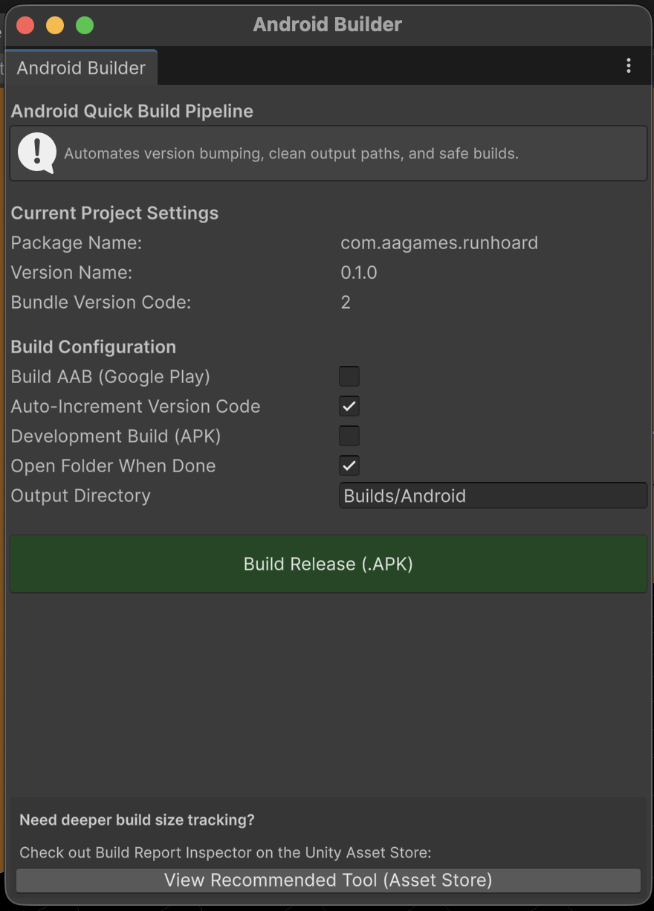

# Unity Android Quick Build Pipeline 🚀

A lightweight, robust Unity Editor tool that automates repetitive Android build tasks. Stop manually bumping version codes, fighting with output directories, or misconfiguring APK/AAB settings.

  

## Features
* **Safe Version Bumping:** Bumps `bundleVersionCode` **only** upon a successful build (never burns version codes on failed builds or missing scenes).
* **Flexible Builds:** Quick toggle between Release AAB, Release APK, and Development APK.
* **Smart Output Naming & Sanitization:** Automatically strips illegal filename characters from your project name and formats builds with clean timestamps (`GameName_v1.0_b12_20261122_1430.aab`).
* **Persistent Window State:** Remembers your toggle configurations and output paths across Unity reloads.

## Installation
1. Download `AndroidBuildPipeline.cs` from this repository.
2. Place it inside an `Editor` folder anywhere in your Unity project (e.g., `Assets/Editor/AndroidBuildPipeline.cs`).
3. Open Unity and navigate to **Tools > Android Build Automator** in the top menu bar.

## License
Distributed under the MIT License. See `LICENSE` for more information.